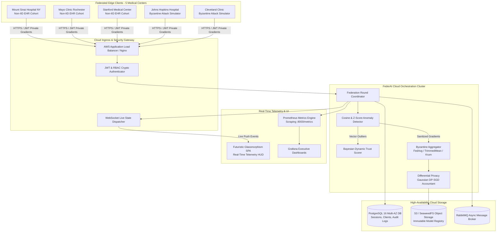

# FederAI Cloud — A Cloud-Native, Secure and Privacy-Preserving Infrastructure for Federated AI

<div align="center">

```
███████╗███████╗██████╗ ███████╗██████╗  █████╗ ██╗     ██████╗██╗      ██████╗ ██╗   ██╗██████╗ 
██╔════╝██╔════╝██╔══██╗██╔════╝██╔══██╗██╔══██╗██║    ██╔════╝██║     ██╔═══██╗██║   ██║██╔══██╗
█████╗  █████╗  ██║  ██║█████╗  ██████╔╝███████║██║    ██║     ██║     ██║   ██║██║   ██║██║  ██║
██╔══╝  ██╔══╝  ██║  ██║██╔══╝  ██╔══██╗██╔══██║██║    ██║     ██║     ██║   ██║██║   ██║██║  ██║
██║     ███████╗██████╔╝███████╗██║  ██║██║  ██║██║    ╚██████╗███████╗╚██████╔╝╚██████╔╝██████╔╝
╚═╝     ╚══════╝╚═════╝ ╚══════╝╚═╝  ╚═╝╚═╝  ╚═╝╚═╝     ╚═════╝╚══════╝ ╚═════╝  ╚═════╝ ╚═════╝ 
```

**Train Together. Share Intelligence, Not Data.**

[](https://www.python.org/)
[](https://fastapi.tiangolo.com/)
[](https://www.postgresql.org/)
[](https://www.docker.com/)
[](https://kubernetes.io/)
[](https://www.terraform.io/)
[](https://prometheus.io/)
[](https://grafana.com/)

---

</div>

## 1. Executive Summary & Vision

Modern artificial intelligence breakthroughs in mission-critical domains (such as healthcare, oncology, rare disease diagnosis, and fraud detection) require massive volumes of diverse training data. However, data in these domains is strictly siloed across institutions due to stringent regulatory privacy mandates (HIPAA, GDPR, CCPA) and intellectual property protections.

**FederAI Cloud** resolves this fundamental tension by establishing a cloud-native, Byzantine-resilient, privacy-preserving infrastructure for Federated Artificial Intelligence. 

Instead of aggregating patient health records into a central data lake, FederAI Cloud coordinates local neural network training on private hospital infrastructure:
1. The global model architecture is dispatched to edge medical institutions.
2. Hospitals compute localized weight updates ($\Delta w_k$) strictly within their secure private boundaries.
3. Updates are protected with **$(\epsilon, \delta)$-Differential Privacy (DP-SGD)** and zero-sum secure masking.
4. Updates pass through **Statistical Anomaly Filtering** (Cosine Alignment & Gradient Norm Z-scores).
5. Updates from untrusted nodes are isolated by the **Dynamic Bayesian Trust Engine**, and honest gradients are aggregated via **Multi-Krum / FedAvg / Trimmed Mean** into a hardened global clinical risk model.

---

## 2. End-to-End System Architecture



---

## 3. Mathematical & Algorithmic Foundations

### 3.1 Distributed Optimization Objective
$$\min_{w \in \mathbb{R}^d} F(w) \triangleq \sum_{k=1}^K \frac{n_k}{N} F_k(w), \quad \text{where } F_k(w) = \frac{1}{n_k} \sum_{i \in \mathcal{D}_k} \ell(f(x_i; w), y_i)$$

### 3.2 Byzantine Anomaly Detection Mechanics
Let $\Delta w_k = w_k - w_{\text{global}}$ be the parameter delta submitted by client $k$. The collective consensus median gradient is defined as $\Delta w_{\text{consensus}} = \text{median}(\{\Delta w_i\}_{i=1}^K)$.

1. **Directional Cosine Alignment:**
   $$\text{CosineSim}(\Delta w_k, \Delta w_{\text{consensus}}) = \frac{\Delta w_k \cdot \Delta w_{\text{consensus}}}{\|\Delta w_k\|_2 \|\Delta w_{\text{consensus}}\|_2}$$
   - *Rule:* If $\text{CosineSim} < 0.0$, the update is classified as a **Sign Inversion Attack** and instantly rejected.

2. **Magnitude Statistical Z-Score Outlier:**
   $$Z_k = \frac{\|\Delta w_k\|_2 - \mu_{\|\Delta w\|}}{\sigma_{\|\Delta w\|} + \epsilon_{\text{stable}}}$$
   - *Rule:* If $Z_k > 3.0$, the update is classified as a **Gradient Scaling Outlier** and quarantined.

### 3.3 Dynamic Bayesian Trust Update
Each node $k$ maintains an adaptive trust score $T_k \in [0, 100]$:
$$T_k^{(t+1)} = 
\begin{cases} 
\min\left(100, T_k^{(t)} + \alpha \cdot \text{Sim}_k\right) & \text{if honest and verified} \\
\max\left(0, T_k^{(t)} - \beta \cdot (1 + Z_k)\right) & \text{if Byzantine attack detected}
\end{cases}$$
Clients with $T_k < 40.0$ enter **QUARANTINE** status.

### 3.4 Local Differential Privacy (DP-SGD)
$$\bar{g} = g \cdot \min\left(1, \frac{C}{\|g\|_2}\right), \quad \tilde{g} = \bar{g} + \mathcal{N}\left(0, \sigma^2 \mathbf{I}\right), \quad \sigma = \frac{C \sqrt{2 \ln(1.25 / \delta)}}{\epsilon}$$

---

## 4. Quickstart Guide (Local Development)

### 4.1 Prerequisites
- Python 3.11+
- Docker & Docker Compose
- Make (optional, but recommended)

### 4.2 Local Python Setup & Verification
```bash
# 1. Clone repository
git clone https://github.com/federaicloud/cloud_federated.git
cd cloud_federated

# 2. Install dependencies
make install
# (or: python3 -m venv .venv && source .venv/bin/activate && pip install -r requirements.txt)

# 3. Seed database
make seed

# 4. Run full test suite (15/15 tests passing)
make test
```

### 4.3 Running the Full Cloud Stack with Docker Compose
```bash
docker compose up -d
```

Verify that all 7 microservice containers are running and healthy:
```bash
docker compose ps
```

| Service | Port | Description |
| :--- | :--- | :--- |
| **Frontend Command Center** | `http://localhost:80` (or `http://localhost`) | Real-time futuristic glassmorphism SPA dashboard |
| **FastAPI Backend Gateway** | `http://localhost:8000` | REST API & Interactive OpenAPI Docs (`/docs`) |
| **SeaweedFS S3 Gateway** | `http://localhost:8333` | High-performance S3-compatible model storage |
| **PostgreSQL 16** | `localhost:5432` | Relational database (DB: `federaicloud`) |
| **RabbitMQ Management** | `http://localhost:15672` | Event broker UI (User: `federai_guest`, Pass: `guest_secure_pass`) |
| **Prometheus Server** | `http://localhost:9090` | Time-series metrics engine |
| **Grafana Dashboard** | `http://localhost:3000` | Visual telemetry (User: `admin`, Pass: `admin`) |

#### Default Seed Credentials:

| Role | Username | Password | Access Level |
| :--- | :--- | :--- | :--- |
| **System Administrator** | `admin` | `AdminPassword123!` | Full platform control, RBAC, sessions & client management |
| **Federation Operator** | `operator` | `OperatorPass123!` | Training orchestration, attack injection & unquarantine |
| **Compliance Auditor** | `auditor` | `AuditorPass123!` | Read-only access to audit logs, security events & models |
| **Hospital Alpha Client** | `client_alpha` | `ClientAlpha123!` | Client node telemetry and gradient submission |

---

## 5. Security & Threat Vector Chaos Testing

FederAI Cloud includes built-in adversarial attack simulation buttons in the UI to demonstrate live Byzantine defense:

| Attack Mode | Technical Vector | Algorithmic Mitigation | UI Indicator |
| :--- | :--- | :--- | :--- |
| **Sign Flipping** | $\Delta w_k \leftarrow -1.5 \cdot \Delta w_k$ | Cosine Anomaly Filter ($\text{Sim} < 0.0$) | Quarantined (Red Warning) |
| **Gradient Scaling** | $\Delta w_k \leftarrow 100 \cdot \Delta w_k$ | L2-Norm Z-Score Outlier Filter ($Z > 3.0$) | Quarantined (Red Warning) |
| **Noise Blasting** | $\Delta w_k \sim \mathcal{N}(0, 2.0)$ | Cosine + Norm Joint Filter | Quarantined (Red Warning) |
| **Label Flipping** | $y \leftarrow 1 - y$ during SGD | Multi-Krum Clustering + Holdout Validation | Trust Score Degradation |

---

## 6. AWS Production Deployment (Terraform & EKS)

### 6.1 Provision Cloud Infrastructure
```bash
cd infrastructure/terraform
terraform init
terraform plan
terraform apply
```

### 6.2 Deploy Kubernetes Manifests
```bash
kubectl apply -f infrastructure/kubernetes/00-namespace.yaml
kubectl apply -f infrastructure/kubernetes/01-configmaps-secrets.yaml
kubectl apply -f infrastructure/kubernetes/02-postgres.yaml
kubectl apply -f infrastructure/kubernetes/03-rabbitmq.yaml
kubectl apply -f infrastructure/kubernetes/04-storage.yaml
kubectl apply -f infrastructure/kubernetes/05-backend-deployment.yaml
kubectl apply -f infrastructure/kubernetes/06-frontend-deployment.yaml
kubectl apply -f infrastructure/kubernetes/07-hpa.yaml
kubectl apply -f infrastructure/kubernetes/08-ingress.yaml
```

---

## 7. Viva Examination & Technical FAQ

### Q1: Why is Differential Privacy necessary if raw data is never transferred?
> **Answer:** Even when raw data never leaves the client, researchers have demonstrated that deep neural network gradients leak training sample details through *gradient inversion* and *membership inference attacks*. By enforcing DP-SGD with bounded gradient clipping $C$ and Gaussian perturbation $\sigma$, we provide mathematical guarantees that the output distribution of the global model cannot be used to infer the presence or absence of an individual patient's record.

### Q2: How does FederAI Cloud handle Byzantine attackers who try to break FedAvg?
> **Answer:** Standard FedAvg computes a simple weighted arithmetic mean, making it vulnerable to a single attacker sending a $1000\times$ scaled gradient. FederAI Cloud uses a multi-tiered defense:
> 1. **Directional Cosine Alignment:** Detects sign flips and backdoors.
> 2. **Statistical Z-Score Filter:** Detects magnitude outliers.
> 3. **Multi-Krum & Trimmed Mean:** Distance-based aggregation discarding $(2f+2)$ outliers.
> 4. **Bayesian Dynamic Trust Scoring:** Quarantines malicious nodes permanently.

### Q3: Why did we choose S3 / SeaweedFS for model storage rather than the relational DB?
> **Answer:** Neural network checkpoints, gradient deltas, and layer tensors are binary blobs (numpy arrays / ONNX artifacts). Storing them in PostgreSQL leads to database bloat and slow transaction logs. S3-compatible object storage provides immutable versioning, zero-downtime rollbacks, pre-signed download URLs, and automatic tiering to cold archive storage (AWS Glacier).

### Q4: How is Non-IID clinical data handled across hospitals?
> **Answer:** In real healthcare settings, demographic distributions vary significantly between hospitals. FederAI Cloud generates heterogeneous non-IID patient cohorts using a Dirichlet distribution ($\alpha = 0.5$). The coordinator employs momentum-based updates and weight decay to ensure stable convergence despite regional variance.

---

## 8. License

This project is licensed under the Apache License 2.0. Copyright (c) 2026 FederAI Cloud Team.
