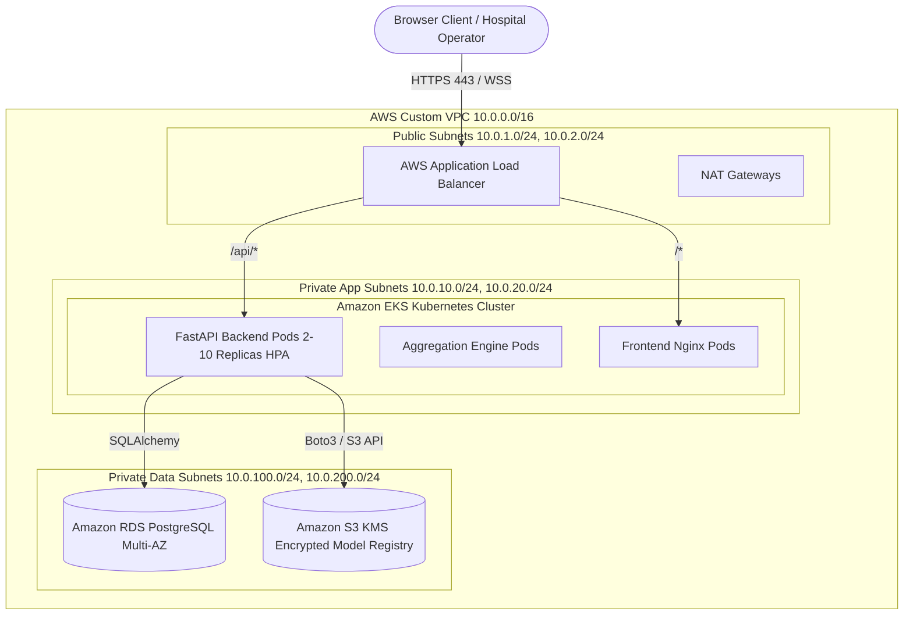

# FederAI Cloud — Cloud & Infrastructure Architecture

## 1. Cloud-Native Topology (AWS Enterprise Deployment)

FederAI Cloud is architected using the AWS Well-Architected Framework across the Reliability, Security, and Cost-Optimization pillars.

---

## 2. Infrastructure Components

### 2.1 Virtual Private Cloud (VPC) & Network Isolation
- **CIDR Block:** `10.0.0.0/16` partitioned across 2 Availability Zones (`us-east-1a`, `us-east-1b`).
- **Subnet Layout:**
  - `Public Subnets`: `10.0.1.0/24`, `10.0.2.0/24` (Hosts ALB, NAT Gateways, Internet Gateway).
  - `Private App Subnets`: `10.0.10.0/24`, `10.0.20.0/24` (Hosts EKS worker nodes; egress via NAT).
  - `Private Data Subnets`: `10.0.100.0/24`, `10.0.200.0/24` (Isolated database and cache tier with zero direct internet access).

### 2.2 Elastic Kubernetes Service (EKS)
- **Control Plane:** Fully managed EKS v1.29 with envelope encryption via AWS KMS.
- **Worker Node Groups:** Auto-scaling managed node groups (`m6i.large`, 2 to 10 nodes) governed by Horizontal Pod Autoscaler (HPA) triggering on 70% CPU / memory utilization.
- **Network Security:** IAM Roles for Service Accounts (IRSA) enforcing least-privilege pod-level AWS permissions.

### 2.3 Managed Relational Database Service (RDS)
- **Engine:** PostgreSQL 16.2 on `db.m6g.large` (AWS Graviton2).
- **High Availability:** Multi-AZ synchronous replication with automated failover (< 60s RTO).
- **Data Protection:** Encrypted at rest via AWS KMS (AES-256) with 30-day point-in-time recovery (PITR).

### 2.4 S3-Compatible Model & Gradient Registry
- **Cloud Mode:** Amazon S3 bucket with S3 Versioning, Server-Side Encryption (SSE-KMS), and Intelligent-Tiering / Glacier lifecycle transition rules.
- **Local Development / Edge Mode:** High-performance SeaweedFS S3-compatible gateway (`chrislusf/seaweedfs`) operating on standard port `8333` with 100% S3 API compatibility.

### 2.5 Edge Ingress & Load Balancing
- **AWS Application Load Balancer:** Path-based layer 7 routing:
  - `/api/*`, `/docs`, `/health`, `/metrics` $\longrightarrow$ FastAPI Core Service Target Group.
  - `/*` $\longrightarrow$ Nginx SPA Static Target Group.
- **Web Application Firewall (WAF):** Enforces rate limiting, SQL injection defense, and Geo-IP restrictions.
