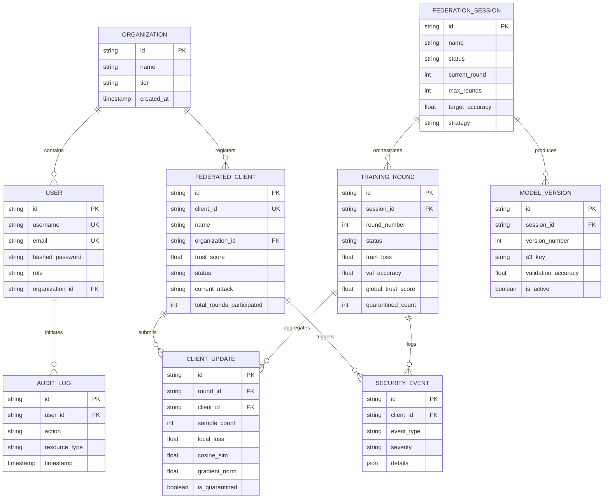

# FederAI Cloud — Database Schema & Data Models

## 1. Relational Architecture (PostgreSQL 16)

The platform utilizes SQLAlchemy ORM with foreign key cascades, unique constraints, and B-Tree indexes for optimal query latency.

---

## 2. Table Specifications

### 2.1 `organizations` & `users`
- Manages multi-tenant hospital organizations and operator user credentials.
- Passwords are encrypted using bcrypt salt rounds with strict length and complexity enforcement.

### 2.2 `federated_clients`
- Represents hospital edge compute nodes participating in training.
- Tracks dynamic Bayesian trust score ($0.0 - 100.0$), active status (`ACTIVE`, `TRAINING`, `QUARANTINED`, `OFFLINE`), and simulated adversarial modes for chaos engineering.

### 2.3 `federation_sessions` & `training_rounds`
- Tracks the lifecycle of multi-round federated training experiments.
- Records global validation accuracy, training loss, execution latency, and participation metrics per round.

### 2.4 `client_updates` & `model_versions`
- Detailed audit records of individual gradient submissions per round, including cosine alignment, gradient L2-norm, and DP noise scale.
- Model checkpoint metadata referencing immutable S3 keys with validation accuracy benchmarks.

### 2.5 `security_events` & `audit_logs`
- Append-only compliance log recording all Byzantine anomaly detections, client quarantines, model rollbacks, and administrative actions for HIPAA/SOC2 compliance.
